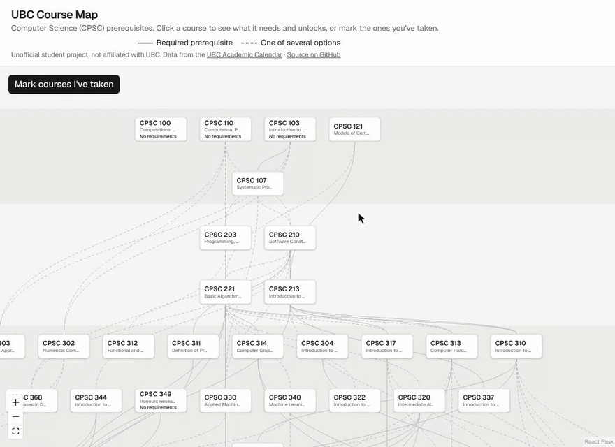

# UBC Course Map


An unofficial prerequisite map for UBC Vancouver: see what each course needs, what it unlocks, and what you can take next.

**Try it: [ubc-course-map.vercel.app](https://ubc-course-map.vercel.app)**



## What it does

- **Prerequisite maps** for 39 subjects across Science, Engineering and Arts, laid out first year to fourth.
- **Click a course** to highlight everything it needs and everything it unlocks.
- **"What can I take next?"** Tick the courses you've done (plus your year standing and high school courses) and every course shows whether you can take it.
- **Shortest path** to any course, term by term, across subjects.
- **Program tracking** for 96 programs (67 B.Sc., 14 engineering, 15 B.A.): requirements year by year, what's done, and the program's courses marked on the map.
- **Grades since 2021** for each course: average, distribution and instructors.

No accounts. Your courses are saved in your browser and never sent anywhere.

## How it works

A Python pipeline builds all the data ahead of time. The website is a static Next.js + React Flow site that only loads the finished JSON.

**Reading prerequisites.** The UBC calendar writes prerequisites as English ("One of CPSC 210, CPEN 221 and …"). The pipeline turns each sentence into a tree of `one_of` / `all_of` groups:

1. Hand-written rules handle about 95% of sentences, and refuse anything they aren't sure about instead of guessing.
2. The rest go to Gemini. Every answer is cached, so each sentence is only sent once and the data rebuilds without an API key.
3. A checker makes sure every tree has exactly the courses in its sentence, with none dropped and none made up.

All 1,445 prerequisites and corequisites (across 3,175 courses) were then checked by hand against the calendar. Program requirements go through the same rules, Gemini, checker and hand-check steps (969 distinct wordings), except Arts Majors, whose pages have no tables and were written out by hand.

**Grades** come from the [UBCGrades](https://ubcgrades.com) API: over a million grades across 9,558 course-terms. Our totals are checked against UBCGrades' own (all 7,644 match). A GitHub Action checks for a new term every month and opens a pull request.

**Some interesting parts of the site:**

- **Three answers, not two.** Each requirement is met, not met, or "check yourself". The site can't know your grades or a department's permission, so it doesn't pretend to.
- **Shortest path** picks the option in each "one of" that avoids last resorts (Science One, co-op terms, courses only some students can take), then the one needing the fewest new courses. For CPSC it was verified against an exhaustive search of every combination.
- **A course counts once.** Toward a program, exact-course requirements claim courses first, then choices, then credit counts, then electives, so nothing is double-counted.
- **Layout.** Rows go by year level, and dagre only orders courses within a row. Packing the rows took a map from about 4,000px wide to 1,800px.
- **Accessible.** Colour-blind-checked highlights with text labels, dark mode, and full keyboard and screen-reader support.

## Running it

Pipeline:

```
python3 -m venv .venv && source .venv/bin/activate
pip install -r pipeline/requirements.txt
pytest
python pipeline/build_prereqs.py    # or: build_prereqs.py MATH STAT / engineering / arts
python pipeline/build_grades.py
python pipeline/build_programs.py
```

A Gemini API key (in `.env`, see `.env.example`) is only needed if the calendar has wording the cache hasn't seen.

Website:

```
cd web
npm install
npm test
npm run dev
```

GitHub Actions runs the 441 pipeline tests and 257 website tests on every push, and [Vercel](https://vercel.com) deploys from `main`.

## Known gaps

- Only Science, Engineering and Arts so far: no language subjects, Arts Honours or engineering options yet.
- Some requirements (department permission, a few credit rules) are shown as "check yourself" instead of being decided.
- Courses from subjects not on the site yet show up with no data.

## Feedback and credits

Something wrong or missing? Use the **Feedback** link on the site (it opens a GitHub issue). The UBC Academic Calendar always has the final word on requirements.

Data: [UBC Vancouver Academic Calendar](https://vancouver.calendar.ubc.ca) (courses and programs) and [UBCGrades.com](https://ubcgrades.com) / UBC PAIR (grades). Not affiliated with UBC.
