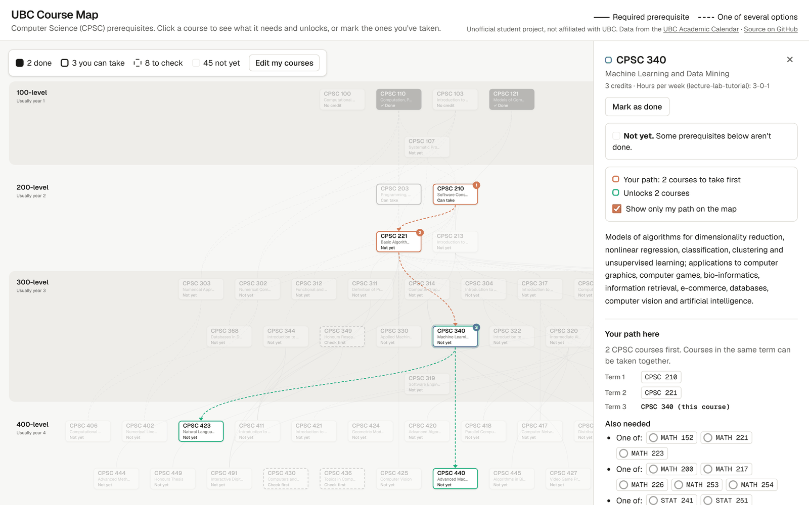

# UBC Course Map


A website for UBC students to plan courses using the prerequisite graph.

> Work in progress. Unofficial, not affiliated with UBC.



## Features

- [x] Prerequisite graph for Computer Science (CPSC), laid out from first year to fourth.
- [x] Click a course to highlight everything it needs and everything it unlocks.
- [x] Course details: description, credits, and the exact prerequisite rule, including courses from other departments.
- [x] "What can I take next?": mark the courses you've done (MATH, STAT and other subjects too) and every course shows whether you can take it.
- [x] The shortest path to any course from the courses you've done, term by term, in the side panel and on the map.
- [ ] Pick a major and see its required courses and how they connect.
- [ ] Teaching history and grade distributions per course (from UBCGrades).
- [ ] Links to r/ubc discussions and RateMyProf for each course and instructor.

## How the course data is built

All of this runs once, ahead of time. The website only loads the finished JSON file.

1. **Parse the calendar.** `parse_courses.py` reads the UBC Academic Calendar page for a subject and gets each course's code, title, credits and description.
2. **Cut out the requirements.** `requisites.py` finds the "Prerequisite:", "Corequisite:" and "Equivalency:" text in each description.
3. **Turn the text into a tree.** "One of CPSC 210, CPEN 221 and …" becomes nested `one_of` / `all_of` groups, with optional minimum grades and free-text requirements like "Third-year standing".
   - **Rules first.** `prereq_tree.py` handles the common patterns (single courses, "One of", "All of", "Either … or", chains joined by "and"). It refuses anything it isn't sure about instead of guessing.
   - **Gemini for the rest.** `llm.py` sends the leftover sentences to Gemini (free tier) with a short prompt and a few examples. Every answer is cached in `data/llm_cache/prereqs.json`, so each sentence is only ever sent once, and the data can be rebuilt without an API key.
   - **Every tree is checked.** A checker makes sure the tree has a valid shape and mentions exactly the courses in the sentence, with none dropped and none made up. Anything it flags is marked for review.
4. **Write the output.** `build_prereqs.py` writes `data/courses/cpsc.json`.

### Accuracy (CPSC, October 2026)

Every parsed prerequisite was checked by hand against the calendar text.

| | Prerequisites | Correct |
|---|---|---|
| Parsed by rules | 37 | 37 |
| Parsed by Gemini | 13 | 12 on the first try, 13 after one prompt fix |
| **Total** | **50** | **49 / 50 (98%) first try, 50 / 50 final** |

The one first-try miss (CPSC 121) treated high school courses as UBC course codes. The checker flagged it automatically, and the prompt was updated.

Known gaps:
- CPSC 448's requirement isn't labelled "Prerequisite:" in the calendar, so it isn't captured.
- "Not for students with credit for …" exclusions aren't extracted by the pipeline yet. The website reads them from the description for now.
- Requirements that aren't courses (year standing, credit counts, department permission) are kept as text, so the website shows them as "check first" instead of deciding.

### Running it

```
python3 -m venv .venv
source .venv/bin/activate
pip install -r pipeline/requirements.txt
pytest
python pipeline/build_prereqs.py
```

A Gemini API key is only needed when there are prerequisites the cache doesn't have yet. Put it in a `.env` file (see `.env.example`).

## The website

The site is in `web/`: Next.js, TypeScript and React Flow, exported as a plain static site. It never calls an API. Everything is worked out when the site is built.

- **Built ahead of time.** A server component reads `data/courses/cpsc.json` during `npm run build`, turns it into a graph and lays it out. The browser only gets the finished positions, so the layout library never ships to it.
- **Laid out in course order.** Rows go by year (all 100-level courses above all 200-level ones, and so on), and a course sits below any prerequisite from its own year (CPSC 103 → 107). [dagre](https://github.com/dagrejs/dagre) only picks the left-to-right order inside each row, through a custom ranker, to keep lines from crossing. The rows are then packed tightly: dagre's own spacing made the graph about 4,000px wide, packed it's about 1,800px.
- **What a course needs and unlocks** is a breadth-first search over the prerequisite edges, in each direction. Solid lines are required, dashed lines are one of several options.
- **Colours** for "needs" and "unlocks" were checked with a colour-blindness validator, and always come with text labels. There's a dark mode, and it works with the keyboard (Tab, Enter, Esc) and screen readers.

### What can I take next?

- **Your courses stay in your browser.** Ticks are saved in localStorage. There are no accounts, and nothing is sent anywhere.
- **Three answers, not two.** Each requirement is met, not met, or "check yourself", because the site can't know your grades, your year standing or whether you took Pre-calculus 12. A "one of" group is met if any option is, an "all of" group fails if any part fails, and anything uncertain stays uncertain (three-valued logic).
- **Five statuses.** Done, can take, check first, not yet and no credit. A corequisite can be taken at the same time, "Restricted to …" sentences make a course "check first", and "Not for students with credit for CPSC 110" makes CPSC 100 "no credit" once 110 is done.
- **Other subjects.** The 53 courses that CPSC prerequisites mention but the map doesn't show (MATH, STAT, CPEN, …) can be ticked too, from a list or right inside a course's prerequisites.
- **Shortest path.** For any course, the side panel lists the CPSC courses still needed, term by term, plus anything else it asks for (e.g. "one of MATH 152, MATH 221, MATH 223"). In each "one of" it picks the option that needs the fewest new courses, counting the ones already picked for other parts of the path. Options from other subjects come last, because their own prerequisites aren't in the data: without that rule, CPSC 340 was routed through DSCI 221. A tie goes against a course that's "not for students with credit for" the other option (CPSC 103 loses to CPSC 110), then to the course that unlocks more. Checked against an exhaustive search over every combination of choices, for all 60 courses from six different starting points, it never needs more courses. A switch shows just that path on the map, with term numbers.

### Running it

```
cd web
npm install
npm test
npm run dev
```

`npm run build` writes the static site to `web/out/`. There are 104 tests (Vitest) for the graph, layout, highlighting, course details, statuses, saving and path logic, including checks against the real CPSC data. GitHub Actions runs `pytest` and the website's tests, lint and build on every push.

## Data credits

Course and prerequisite data: [UBC Vancouver Academic Calendar](https://vancouver.calendar.ubc.ca).

Grade and instructor data: [UBCGrades.com](https://ubcgrades.com) / UBC PAIR. Not affiliated with UBC.
